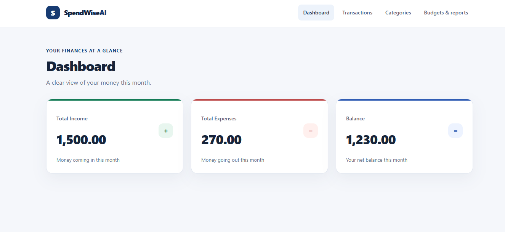
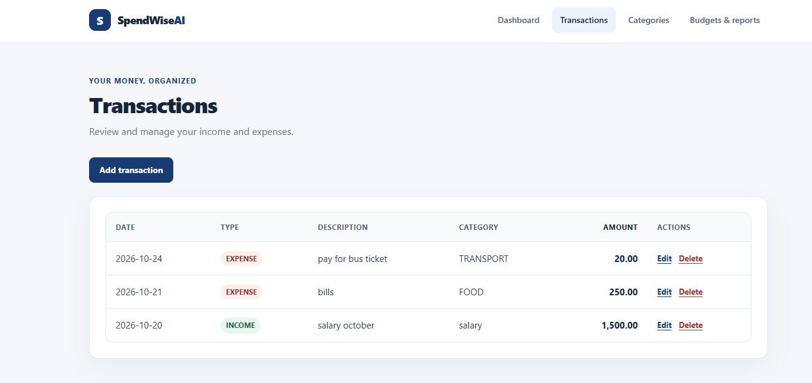
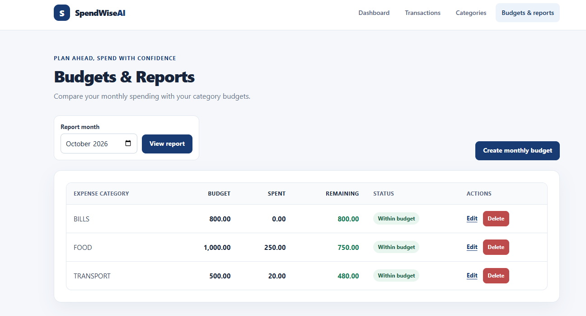

# SpendWise AI

SpendWise AI is a server-rendered personal finance application for recording income and expenses, organizing transactions into categories, and comparing monthly spending with category budgets. It is built with Java 25 and Spring Boot 3.5.6, with MySQL for application data.

Despite the project name, the application does not currently use AI to analyze financial data or make recommendations. AI-assisted development tools were used during development.

## Features

- **Monthly dashboard:** View current-month income, expenses, and balance.
- **Transaction management:** Create, list, edit, and delete income and expense transactions.
- **Categories:** Create and list income and expense categories. Transaction categories must match the transaction type.
- **Monthly budgets:** Create, edit, and delete one budget per expense category and month.
- **Budget reports:** Select a month to view each expense category's budget, spending, remaining amount, and status (within budget, over budget, or no budget).
- **Validation and error handling:** Validate submitted forms, display field errors, and show not-found pages for missing transactions and budgets.
- **Persistent storage:** Store application data in MySQL.

## Screenshots

### Dashboard



*Current-month income, expenses, and balance at a glance.*

### Transactions



*Review recorded income and expenses, with category, date, and amount.*

### Monthly Budgets



*Compare category budgets with spending, remaining amounts, and budget status.*

## Technology Stack

- Java 25
- Spring Boot 3.5.6
- Spring MVC and Thymeleaf
- Spring Data JPA and Hibernate
- MySQL
- Maven
- JUnit 5 and Mockito
- H2 for automated persistence tests
- HTML and CSS

## Architecture

The project uses a layered Spring application structure:

- **Controllers** handle web requests, bind and validate form input, and select the Thymeleaf view to render.
- **Services** implement application operations and business rules, such as transaction summaries, category checks, and budget reports.
- **Repositories** use Spring Data JPA to query and persist entities.
- **Entities** represent categories, transactions, and monthly budgets stored in the database.
- **Forms** hold submitted web-form data and its validation constraints.
- **Thymeleaf templates** render the dashboard and transaction, category, and budget pages on the server.

The main Java package is `com.example.spendwise`.

## Prerequisites

- JDK 25
- Apache Maven
- MySQL Server

Confirm Java and Maven are available:

```shell
java -version
mvn -version
```

## Configure MySQL

The application expects a MySQL database named `spendwise`. Create it and a local application user using a MySQL administrator account (replace the placeholder with a password chosen for your own environment):

```sql
CREATE DATABASE spendwise;
CREATE USER 'spendwise_user'@'localhost' IDENTIFIED BY '<choose-a-local-password>';
GRANT ALL PRIVILEGES ON spendwise.* TO 'spendwise_user'@'localhost';
```

The application configuration reads `DB_URL`, `DB_USERNAME`, and `DB_PASSWORD`. The default URL is:

```text
jdbc:mysql://localhost:3306/spendwise?createDatabaseIfNotExist=true
```

The project imports an optional root `.env` file as Spring properties. For local development, create `.env` in the project root:

```dotenv
DB_URL=jdbc:mysql://localhost:3306/spendwise?createDatabaseIfNotExist=true
DB_USERNAME=spendwise_user
DB_PASSWORD=<your-local-password>
```

Alternatively, set these environment variables in the shell that will run Maven. `DB_USERNAME` and `DB_PASSWORD` must be supplied; `DB_URL` has the default shown above.

Hibernate is configured with `spring.jpa.hibernate.ddl-auto=update`, so it updates the schema as needed when the application starts. This is not a substitute for versioned database migrations in a production deployment.

## Run the Application

Start MySQL, configure the database and credentials, and run from the project root:

```shell
mvn spring-boot:run
```

Open [http://localhost:8082](http://localhost:8082). The application listens on port `8082`. Stop it with `Ctrl+C` in the terminal.

Create categories before recording transactions or setting budgets. Budgets can only be assigned to expense categories.

## Automated Tests

Run the Maven verification lifecycle from the project root:

```shell
mvn clean verify
```

The automated tests use JUnit 5 and Mockito, with H2 for persistence tests so they do not require the application MySQL database.

**Latest verified test result:** 62 tests, 0 failures, 0 errors, and 0 skipped tests.

## Limitations and Future Improvements

The current application is designed for local, single-user use. It does not provide authentication, multi-user accounts, external financial integrations, transaction import/export, recurring transactions, or savings goals. AI-powered financial analysis and recommendations are not implemented.

Potential future improvements include authentication and user-specific data, database migrations, transaction import/export, recurring transaction support, and optional financial insights. These would require additional design and security work before use with sensitive or shared data.

## AI-Assisted Development

AI-assisted development tools were used to support implementation and testing. The application itself does not currently include an AI service or AI-powered financial analysis.

## Configuration and Secrets

The repository's `.gitignore` excludes `.env` and `.env.*` files (except `.env.example`). Keep real database credentials in local environment configuration and never commit passwords, tokens, or other secrets. Use placeholders in shared examples.

## License

No license has been specified yet.
